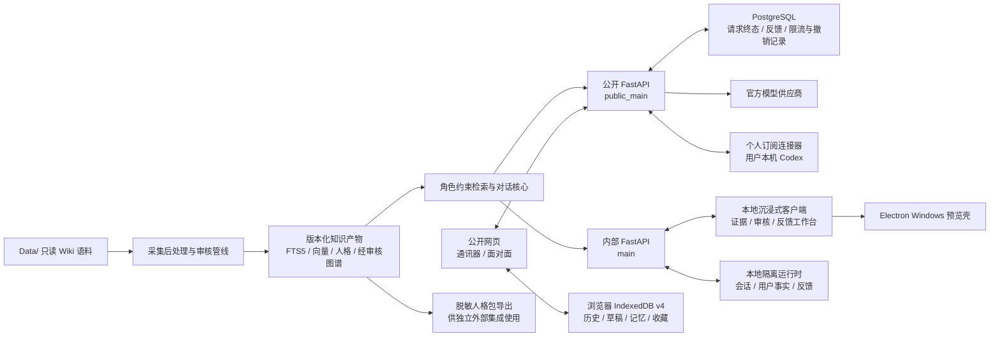

# 小吉终端 · Project Snow

> 让角色带着她在故事中的经历、关系与性格，与你继续交谈。

小吉终端是以《尘白禁区》公开 Wiki 资料为知识基础的非官方、非商业角色互动实验。
项目围绕 22 名角色，把可追溯检索、人格约束、场景连续性与浏览器本地历史结合起来，
提供通讯器文字交流和视觉小说式面对面对话。模型回答仍可能出错或偏离原作。

**[在线体验](https://snow.xiaob.dev)** ·
[1.0.0 发布说明](App/docs/release-1.0.0.md) ·
[个人订阅连接教程](App/docs/codex-subscription-connector.md) ·
[隐私与素材说明](https://snow.xiaob.dev/privacy/)

本文按 **2026-10-21 的主线代码**整理。公开 Web/API 版本为 **1.0.0**，Windows 本地预览独立保持
**0.5.0**；版本选择见 [前端发布配置](App/config/public_frontend_release.json)。功能是否对外开放还取决于
部署开关，生产上线状态以具体候选的验收与发布回执为准。
小吉终端是正式公开名称，仓库、API、部署及已有存储标识继续使用 Project Snow，以保持兼容。

**导航：** [最新更新](#最新更新) · [当前能力](#当前能力) · [总体架构](#总体架构) ·
[项目结构](#项目结构) · [本地开发](#本地开发) · [验证与发布](#验证与发布) ·
[数据与隐私](#数据与隐私) · [文档索引](#文档索引)

## 最新更新

| 日期 / 阶段 | 主线更新 |
|---|---|
| 2026-10-21 | 新增记忆档案、台词收藏、本机图片卡和当前角色的完整历史搜索；面对面长台词分页、自动翻页、文字速度与已读控制；新增当天约定提醒及每轮模型用量显示。22 名角色各有 8 种日常活动，共 176 条。 |
| 2026-10-21 | 集成可选的角色主动消息和本机凭证保存。两者均受服务端开关控制，并要求用户确认；主动消息默认关闭，详见下方说明。 |
| 2026-10-21 | 面对面回复进度、停止等待和重试改为对白框上方的浮动标签，减少舞台、立绘和输入区随状态变化而跳动。 |
| 2026-10-19 | 新增基地平面图，查看本机记录的角色位置与活动，并沿既有流程前往见面；打开地图不调用模型。 |
| 2026-10-17 ～ 18 | 完善雪境界面、雪白/暮色/深色色调、转场与手机布局；角色图层改用 WebP 交付，保留头像及整图后备。 |
| 1.0.0 | 支持个人 Codex 订阅连接、账号可用模型与推理强度选择；改善表情与对白同步、角色切换、图片加载及文字聊天布局。 |

完整用户更新见 [站内公告](App/public_frontend/announcements.json)。这些更新延续 `/public/v1`、
`public-state-2`、IndexedDB v4 和既有请求快照的兼容约定。数据、头像、贴纸与角色舞台资源按独立清单发布，
不随应用版本号一并重置。

## 当前能力

### 角色、证据与共同经历

- **22 名统一注册角色**：里芙、芬妮、凯茜娅、猫汐尔、芙提雅、伊切尔、克罗瑞娜、卜卜、
  奈莉德、妮塔、安卡希雅、恩雅、晴、琴诺、瑟瑞斯、米娅、肴、胧嫣、苔丝、茉莉安、薇蒂雅、辰星。
  名字与全名归一，NPC 和世界观实体不会自动进入角色选择器。
- **证据约束的混合检索**：SQLite FTS5 词法召回、本地中文向量与 RRF 融合，结合经审核的关系图谱。
  人格资料保留来源与层级，未审核关系不会自动成为正式设定。
- **原作设定与用户经历分离**：主线、个人故事、语音、邮件、时装等公开资料构成人格依据；
  本机共同经历与原作事实分开使用，聊天不会改写公共知识。
- **可管理的记忆档案**：查看她记住的话、共同经历与承诺，按类别筛选、确认删除，并在关闭档案前撤销。
  资料不足时保守表达，不借用其他角色的私人关系或口癖。

### 通讯器与面对面

| 体验 | 当前行为 |
|---|---|
| 通讯器文字交流 | 按消息块显示文字与贴纸，不把物理接触或看见用户表情当作已发生事实。 |
| 面对面对话 | 分离动作与对白，支持场景、表情和轻量舞台演出；长台词分页，可手动或自动翻页。 |
| 雪境界面 | 视觉小说式舞台与通讯器，支持雪白、暮色、深色色调及减少动态效果。 |
| 位置与约定 | 基地地图、角色位置与活动、前往见面及当天约定；过期位置明确标注。 |
| 历史与收藏 | 当前角色的本机完整历史搜索、台词收藏、上下文跳转，以及在浏览器生成的 1080×1350 图片卡。 |
| 阅读与用量 | 文字速度、自动翻页停留时间、已读控制；显示调用次数和 token，缺失用量不伪装成零或费用估算。 |

普通约定提醒只在页面打开时生效，不调用模型。**角色主动消息是另一个可选功能**：部署启用、用户开启并
确认费用后，约定提醒到点时可生成一条消息；每条调用一次模型，每个约定最多 1 条、每天最多 3 条，
页面关闭时不生成，也不离线补发。

### 模型连接与请求恢复

- **API Key**：支持已配置的官方模型供应商；默认凭证仅保存在当前标签页，最长 12 小时且不滑动续期。
  部署开放后，可主动确认在本机保存 2 小时、24 小时、3 天或 7 天，并可清除、撤销模型会话。
  长期保存适用于 API Key 凭证；Codex 配对仍只保存在当前标签页。
- **个人 Codex 订阅**：每位使用者在自己的电脑登录并运行个人连接器，网页选择账号实际支持的模型与推理强度。
  登录凭据留在本机；使用各自订阅额度，模型权限与限流以当前账号为准。
- **故障恢复**：请求编号、输入快照与终态记录用于幂等和恢复。付费调用结果不确定时先查询原请求，
  不盲目生成第二次请求；已确认失败后的显式重试保留清晰边界。

公开网页无需注册，不提供跨设备账号同步。API Key 和请求内容仍经本站中转到所选供应商；
订阅模式也会经过本站中转，再由个人连接器调用本机 Codex。详见 [隐私说明](https://snow.xiaob.dev/privacy/)。

## 总体架构



公开应用与内部工作台使用独立入口。`backend.snow_app.public_main` 只挂载公开服务，不暴露内部
`/api/v1` 工作台；`backend.snow_app.main` 用于本地产品和开发调试。
公开浏览器保留完整历史，每轮仅发送请求所需的有限历史、相关经历与检索上下文。

生成链路按当前角色、媒介和场景约束证据与内容块，进行输出校验、有限重写和确定性兜底。
向量或图谱故障可受控降级；数据库和请求终态处理失败时保守拒绝，避免不明确的重复付费调用。

### 技术栈

| 层级 | 主要技术 |
|---|---|
| 后端与管线 | Python 3.11+、FastAPI、Pydantic、Uvicorn、HTTPX |
| 公开网页 | 原生 HTML/CSS/JavaScript；TypeScript 边界模块，esbuild 构建；Node.js 22+ 开发工具 |
| 本机与知识存储 | IndexedDB v4、SQLite FTS5、JSON/JSONL、DuckDB |
| 公共服务持久化 | PostgreSQL、SQLAlchemy、Alembic 迁移 |
| 语义与图谱 | Sentence Transformers；可选 Qdrant、Neo4j 服务投影 |
| 桌面预览 | Electron、electron-builder，Windows portable 测试壳 |
| 交付与验证 | pytest、Node test、Playwright/Chromium、GitHub Actions、不可变镜像与签名发布产物 |
| 部署与实验环境 | Docker Compose、Caddy、Cloudflare Tunnel；独立 data-lab 实验配置 |

## 项目结构

```text
Project_Snow/
├── .github/workflows/           CI、夜间健康/安全检查、镜像与发布证明
├── App/
│   ├── backend/snow_app/        角色/RAG 核心、公开与内部 API、请求恢复、反馈
│   │   ├── public_main.py       独立公开服务入口
│   │   ├── main.py              本地应用与内部工作台入口
│   │   ├── admin_main.py        私有反馈管理入口
│   │   └── persona_export.py    脱敏人格包导出器
│   ├── public_frontend/         公开客户端、雪境界面、功能模块、公告与隐私页面
│   │   └── downloads/          用户本机运行的个人订阅连接器
│   ├── public_frontend_src/     TypeScript 边界模块及 Node 测试、构建工具
│   ├── frontend/               本地客户端、工作台与共享设计/沉浸式资源
│   ├── compat/                 固定 0.9.6 基线及补丁的兼容前端构建输入
│   ├── client/                 Electron Windows 本地预览壳
│   ├── config/                 公共知识、前端选择、数据/媒体版本及发布契约
│   ├── pipelines/              湖仓、索引、人格、图谱候选与审核管线
│   ├── migrations/             PostgreSQL / Alembic 迁移
│   ├── infra/                  容器、代理、数据库与 embedding 服务配置
│   ├── ops/                    候选验收、蓝绿发布、备份与回滚控制
│   ├── scripts/                本地开发、资源构建与验证脚本
│   ├── data_lab/               Kafka / Spark / Hive / MinIO 实验配置
│   ├── tests/                  Python、Node、浏览器与兼容性回归
│   ├── docs/                   架构、契约、发布记录、验收与功能说明
│   ├── runtime/                本地派生数据与私密状态（Git 忽略）
│   ├── compose.yml             本地 dev / test / data-lab 配置
│   ├── compose.prod.yml        独立公开服务的生产部署配置
│   └── .env.example            无密钥的本地配置模板
├── Data/                       本机 Wiki 原始资料（不随仓库分发）
├── docs/                       跨模块说明，如统计契约
├── AGENTS.md                   工程与交付约束
├── README.md                   GitHub 项目总览
└── LICENSE                     GPL-3.0
```

`public_frontend_src/` 构建出的 `public_frontend/modules/runtime.js` 与源码一同提交；网页仍使用原生 DOM。
生产镜像从已提交内容准备并指纹化前端，不需要 Node 运行时。`compat/` 保留可重建的兼容产物来源，
每个镜像只选择一套前端，选择由 [发布配置](App/config/public_frontend_release.json) 固定。

外部人格集成已拆到独立仓库 [Snow Role Assistant](https://github.com/X1aoB/Snow_Role_Assistant)。
本项目只保留公开人格包导出契约；旧 AgentRuntime 仅作内部工作台的 legacy 调试基线。

## 本地开发

### 准备环境

- Python **3.11+**，Node.js **22+**；Windows 桌面预览主要在 Windows 10/11 验证。
- 源码不含 Wiki 语料和完整运行时知识包。完整角色检索需要另行准备的本地 `Data/` 或已验证数据包。
- 模型回复需要用户自己的 API Key，或已启用的个人订阅连接。无凭证可检查页面与部分工作台功能。
- Docker Desktop/Compose 为可选项，用于服务化开发与隔离集成测试。

以下命令从仓库根目录进入 `App/`，首次配置时执行：

```powershell
cd App
python -m venv .venv
.\.venv\Scripts\Activate.ps1
python -m pip install --upgrade pip
python -m pip install -r requirements.txt
python -m pip install --require-hashes -r requirements-test.txt
npm ci --prefix public_frontend_src
Copy-Item .env.example .env
```

只在本机 `.env` 填写模型配置。最小本地聊天配置为：

```dotenv
MVP_CHAT_ENABLED=true
MVP_CHAT_PROVIDER=openai-compatible
MVP_CHAT_BASE_URL=https://your-provider.example/v1
MVP_CHAT_API_KEY=replace-with-your-local-key
MVP_CHAT_MODEL=your-model-name
```

这些变量用于本地应用；公开服务有独立的供应商白名单、密钥边界、数据库与部署配置，
不要直接把开发服务器作为公网服务。详细配置见 [应用开发说明](App/README.md) 与
[公开部署说明](App/docs/public_deployment.md)。

### 构建本地知识与启动

已有 `Data/` 时，在 `App/` 中构建派生资料：

```powershell
python -m pipelines.run_stage --stage b --skip-vector
python -m pipelines.run_stage --stage c
python -m pipelines.build_dialogue_profiles
python -m pipelines.build_mvp_views
# 可选：构建本地语义向量索引
python -m pipelines.build_vector_index
```

管线以只读语料为输入，派生产物写入 `runtime/`；重建须保留审核决定与来源记录。
在已激活虚拟环境的两个终端中分别运行：

```powershell
# 终端一，工作目录 App/
python -m backend.snow_app.main

# 终端二，工作目录 App/
python scripts/dev_server.py
```

打开 [本地入口](http://127.0.0.1:8080/)、[沉浸式客户端](http://127.0.0.1:8080/immersive/)
或 [内部工作台](http://127.0.0.1:8080/workspace/)。本地入口与公开站点是独立产品面，
公开服务的 PostgreSQL、前端产物和部署步骤见部署文档。

本地 API 与 Web 启动后，可在 `App/client/` 执行 `npm ci`、`npm start` 运行 Electron 预览；
`npm run package:win` 生成 portable 程序。桌面壳不打包 Python、语料和模型凭据，仍依赖本地服务。

## 验证与发布

统一验证从 `App/` 执行，使用 pytest 作为 Python 测试入口：

```powershell
.\scripts\validate_all.ps1
# 可选：安装浏览器后运行隔离浏览器回归
python -m playwright install chromium
.\scripts\validate_all.ps1 -Browser
```

默认验证包含可移植 Python 测试、TypeScript 检查、Node 测试及构建一致性；Docker 可用时检查 Compose 配置。
`-Desktop` 增加已安装 Electron 的品牌 smoke，`-RuntimeData` 显式验证已安装的私有运行时知识包。
真实 PostgreSQL 测试要求隔离的 `TEST_POSTGRES_URL`，不得使用生产数据库或真实用户历史。
普通 CI 不进行付费模型调用。修改前端边界模块后，应提交对应构建产物，并保持以下命令无差异：

```powershell
npm run check --prefix public_frontend_src
npm test --prefix public_frontend_src
npm run build --prefix public_frontend_src
git diff --exit-code -- public_frontend/modules
git diff --check
```

GitHub Actions 负责契约、浏览器、真实 PostgreSQL 兼容性、桌面 smoke 及镜像安全等检查，
具体任务依事件与变更范围选择；主线推送仍会运行完整发布验证。
**代码合并、自动构建和自动 QA 不等于人工验收或生产晋级。** 发布须绑定确切提交、镜像、数据/媒体、
前端产物与候选回执，并保留可重建回滚锚点。
历史 **0.9.6 基线 `502ec99412bef843c37e4b31a53df8fa9faeb33c`** 继续保留。

## 数据与隐私

- **源资料只读**：`Data/` 不随源码分发；索引、审核队列与派生产物保存在版本化运行时目录。
  人工审核决定与来源证据不能在重建中丢失。
- **浏览器本地历史**：聊天、草稿、收藏和经历保存在当前浏览器 IndexedDB，不自动跨设备同步。
  导出备份不包含模型凭据或可搬移的签名场景权威状态；用户可导出、清理或删除本地数据。
- **生成仍需传输内容**：当前请求、有限历史、相关经历及检索资料会经本站传给所选模型服务。
  服务器不持久保存原始 API Key；加密凭证不是端到端加密。反馈可附带用户选择提交的上下文。
- **访问统计可选**：浏览器访问统计默认关闭，可撤销；基础服务质量统计与其独立，详细范围和保留期限见隐私页面。
- **媒体独立许可**：角色资源按来源、使用决定、manifest 和 SHA-256 校验；缺失或验证失败时保留后备图或文字回退。
  现有舞台基于图片/图层与轻量演出，不代表已集成 Live2D/Cubism；公共语音仍未开放。
- **脱敏导出**：`persona_export.py` 只输出公开人格资料与审核后的公共关系，不读取私聊、用户事实或 Agent 状态库。

不要提交 `.env`、API Key、Cookie、证书、私有资料、SQLite、用户反馈、日志、测试截图、
`node_modules/` 或桌面构建产物。提交前检查 `git status --short` 和 `git diff --check`。

## 文档索引

| 文档 | 内容 |
|---|---|
| [应用开发说明](App/README.md) | 本地服务、工作台、模型配置与桌面预览 |
| [架构与故障边界](App/docs/architecture.md) | 检索、媒介、幂等恢复、降级与运行时边界 |
| [数据契约](App/docs/data_contract.md) | 只读数据、派生资料与证据关联 |
| [公开部署](App/docs/public_deployment.md) | PostgreSQL、模型供应商、数据安装、备份和公开服务配置 |
| [候选验收](App/docs/candidate_acceptance.md) | 候选身份、人工回执、晋级与回滚门禁 |
| [1.0.0 发布说明](App/docs/release-1.0.0.md) | 版本兼容、个人订阅与聊天呈现更新 |
| [个人订阅连接教程](App/docs/codex-subscription-connector.md) | 本机连接器、配对、模型选择与故障处理 |
| [公开前端模块](App/public_frontend_src/README.md) / [兼容前端](App/compat/README.md) | 构建、指纹资源、浏览器可靠性与旧→新→旧验证 |
| [角色媒体发布](App/docs/character_runtime_release.md) | 批准清单、分层资源、WebP 交付及回退规则 |
| [关系审核](App/docs/relation_review_guide.md) / [实体审核](App/docs/entity_node_review_guide.md) | 候选证据与公共知识审核 |
| [历史重构记录](App/docs/overhaul_progress.md) | 早期重构与当时的验收证据；当前状态以最新配置和发布记录为准 |

项目从 Wiki 采集、人格优先检索和关系审核，逐步扩展到 22 角色、本地聊天产品、独立公开服务及雪境体验。
后续改进继续围绕资料覆盖、角色自然度、连续性、可恢复性和真实反馈展开。

## 许可证

本仓库源代码与文档采用 [GNU General Public License v3.0](LICENSE)。第三方 Wiki、游戏文本、图片、
音频与字体有各自的权利和许可边界，不能因应用使用 GPL-3.0 就推定可自由再分发；具体来源与处理见
[隐私与素材说明](https://snow.xiaob.dev/privacy/)。本项目与游戏官方无隶属或背书关系。
